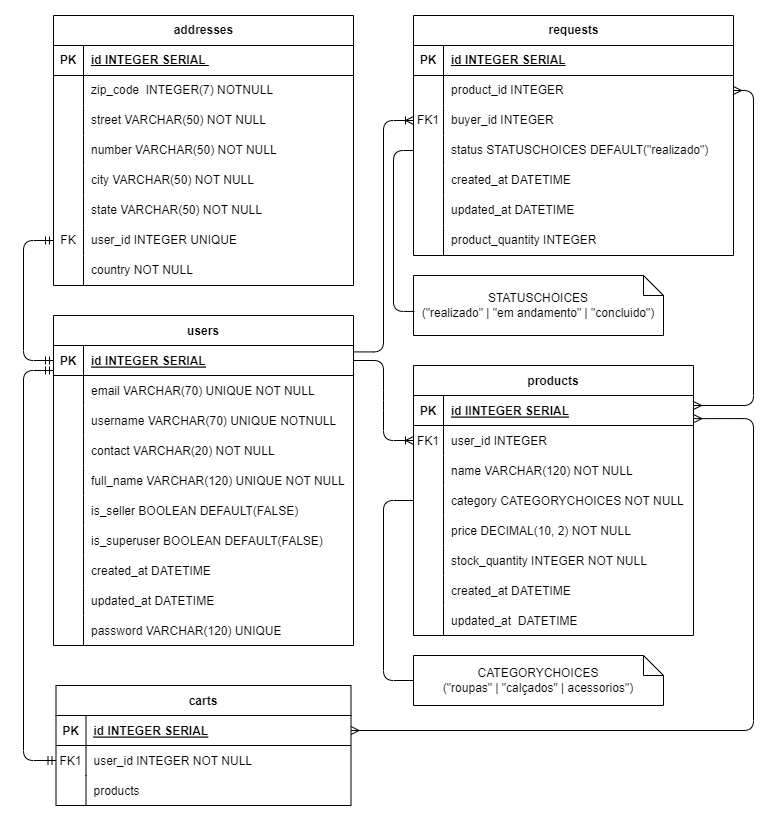
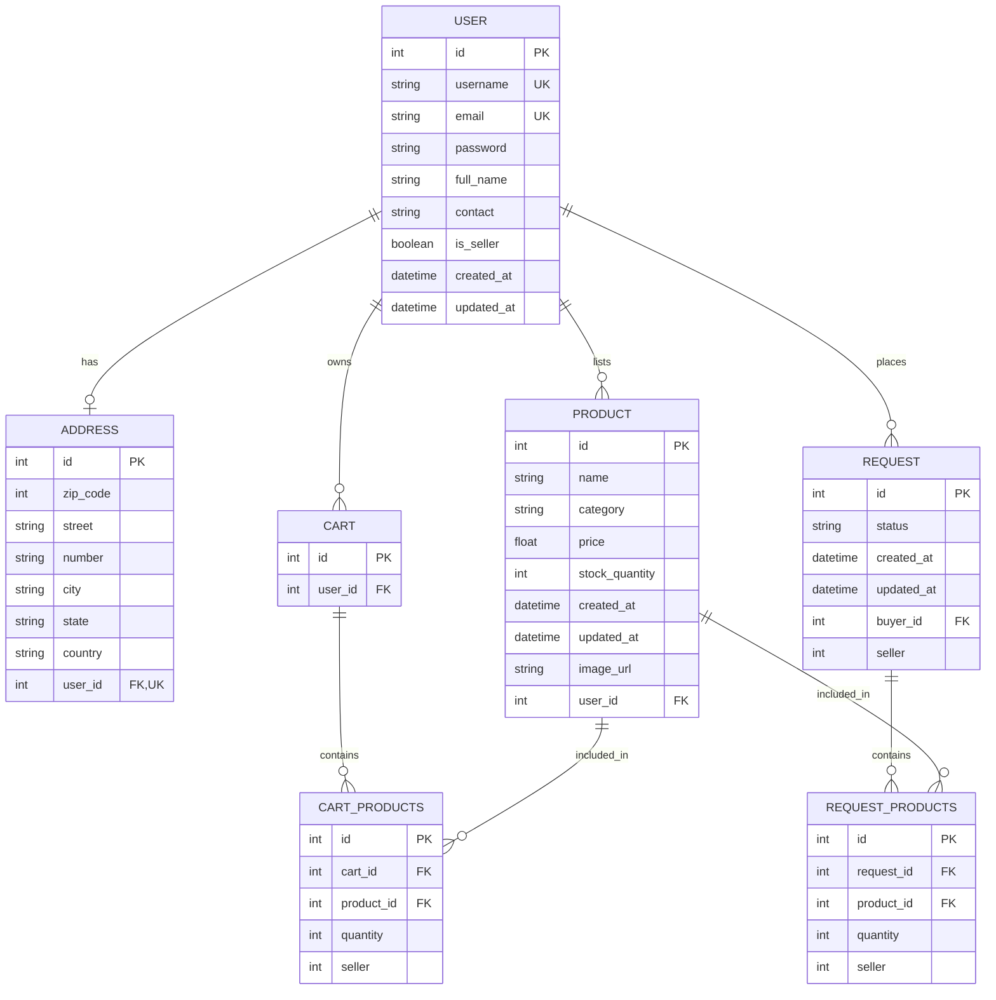

# STREET SQUAD REST API

Street Squad is an e-commerce API for buying and selling clothing. It connects sellers and buyers, and relates users to products based on their needs and interests.

This project was originally developed as a final project for the M5 module at Kenzie Academy Brasil and was later copied from the bootcamp organization into this repository.

## Diagrams

### Entity-Relationship Diagram

The local PNG is the original entity-relationship diagram (ERD), not an MVP diagram. It is kept below as a historical snapshot. The Mermaid ERD is editable directly in this Markdown file and reflects the Django models currently in this repository.

`USER` also inherits Django's standard user fields from `AbstractUser`; only the most relevant fields are shown. Product categories are `roupas`, `calçados`, and `acessorios`; request statuses are `realizado`, `em andamento`, and `concluido`. The `seller` fields on cart and request records are integers, not foreign keys in the current models.

## User Types and Access Levels

The API defines four access levels, each with different permissions and functionality:

- Unregistered visitors
- Registered users
- Sellers
- Administrators

### Unregistered visitors

- Browse products.
- Register on the platform.

### Registered users

- Browse products.
- Add products to their shopping cart.
- Place orders using the products in their cart.
- View their orders.
- Become a seller.

### Sellers

- Create products through the API.
- Update or delete their products.
- View their products.
- View incoming orders.
- Use all shopping features available to customers.

### Administrators

- Access all API endpoints.
- Create, update, or delete any user.
- Update or delete any product.
- Use all shopping features available to customers.

## API Routes

These routes are defined by this project's Django URL configuration. The `/api/` prefix is part of each local URL, not a separate external service. For example, with Django running locally, `GET http://127.0.0.1:8000/api/products/` reaches the product endpoint.

- Users: `/api/users/`, `/api/users/login/`, `/api/users/<id>/`
- Products: `/api/products/`, `/api/products/<id>/`, `/api/products/<id>/add/`
- Addresses: `/api/users/<id>/addresses/`, `/api/users/<id>/addresses/create/`
- Carts: `/api/users/mycart/`, `/api/users/mycart/<id>/`
- Orders: `/api/users/requests/`, `/api/requests/<id>/`, `/api/requests/all/`

## Technologies

- Python
- Django
- PostgreSQL
- Git
- GitHub
- Render
- Jira
- Slack
- diagrams.net

## Project Overview

This project delivers an API for an e-commerce platform with multiple access levels. Its goal was to provide the core functionality needed to serve buyers and sellers.

The project began with a minimum viable product (MVP) that defined the essential features for an initial release. The data model connects users, products, addresses, carts, and orders.

Product management includes searching by name, category, and ID, as well as managing stock. Products become unavailable when their stock reaches zero. The API also handles attempts to purchase unavailable products that are already in a user's cart.

The shopping cart lets users select products before checkout. An order can only be placed when sufficient stock is available. If a cart contains products from different sellers, the API creates a separate order for each seller.

Orders move through statuses such as Placed, In Progress, and Delivered. Buyers receive an email when an order is updated. Orders retain details about purchased products, but not their current stock quantity. Sellers can update order statuses, and order creation times are recorded for traceability.

Users can associate an address with their account to simplify delivery management. The platform supports administrators, sellers, and customers. Administrators have full access and can promote regular users to sellers. Sellers can create products, manage stock, and review orders. Customers can become sellers, add products to their carts, and place orders. Unauthenticated visitors have limited access to product information.

Together, these features provide a foundation for managing products, carts, orders, users, and delivery information in an e-commerce platform.

## Contributors

This project was developed by:

- [Wellington Eugenio de Paula](https://www.linkedin.com/in/wellington-depaula/)
- [André Luiz Cavalcante](https://www.linkedin.com/in/andrzcavalcante/)
- [José Gabriel Souza](https://www.linkedin.com/in/jos%C3%A9gabrielsouza/)
- [Lucca Cruz](https://www.linkedin.com/in/luccaseabracruz/)

## Acknowledgments

We would like to thank Kenzie Academy Brasil, its instructors, and its mentors for their valuable contributions and support throughout this project.

We are especially grateful to instructors Lucira Silva, Alexandre Alves, and Pedro Hasler. Their expertise, guidance, technical knowledge, and encouragement were invaluable throughout the project.

We also thank the M5 module mentors for their guidance, answers to our questions, and feedback. Their availability and patience helped us work through challenges and improve our project.

Working together as a committed team and completing a functional e-commerce API was a rewarding experience. We are proud of what we built and grateful to everyone who supported us.

Sincerely,

Team G28: Lucca Cruz, André Luiz Cavalcante, José Gabriel Souza, and Wellington Eugenio de Paula
